<picture><source media="(prefers-color-scheme: dark)" srcset="assets/hero-dark.svg"></picture>

## 🛠️ What I'm building

- **[Uno Platform](https://github.com/unoplatform/uno)** is the open-source framework that runs WinUI apps on iOS, Android, macOS, Linux, Windows and WebAssembly from one C#/XAML codebase. I'm its No. 1 contributor since it went open source. Right now I'm porting WinUI's C++ internals 1:1 into C# (the text tree and selection engine behind RichTextBlock, ScrollView, the ItemsRepeater layouts), moving every platform onto a single Skia rendering pipeline for 7.0, and chasing allocations and frame-time regressions across six targets with profilers and A/B benchmarks.
- **[WinUI](https://github.com/microsoft/microsoft-ui-xaml/pulls?q=author%3AMartinZikmund)**: porting means reading WinUI's C++ core line by line, so I find bugs in WinUI itself. I send the C++ fixes upstream (layout passes, visual states, RTL mirroring, selection and focus handling in controls like TabView, NavigationView, CommandBar and TreeView). I also check Uno's behaviour against native WinUI with runtime tests on the Windows App SDK.
- **AI-assisted engineering**: I built most of the [Claude Code](https://claude.com/claude-code) agent setup the Uno repo runs on, with skills for porting WinUI code, running test suites and reviewing changes.
- **Quality and UX**: 3,200+ issues filed across Uno Platform repos. If a pixel is off, I'll find it.

<picture><source media="(prefers-color-scheme: dark)" srcset="assets/skills-dark.svg"></picture>

## 🎮 Side projects

<p>
<a href="https://github.com/MartinZikmund/UnoDoom"><picture><source media="(prefers-color-scheme: dark)" srcset="assets/project-unodoom-dark.svg"></picture></a><a href="https://github.com/MartinZikmund/daily-plants"><picture><source media="(prefers-color-scheme: dark)" srcset="assets/project-dailyplants-dark.svg"></picture></a><a href="https://github.com/MartinZikmund/awesome-uno-platform"><picture><source media="(prefers-color-scheme: dark)" srcset="assets/project-awesome-dark.svg"></picture></a>
<a href="https://github.com/MartinZikmund/advent-of-code"><picture><source media="(prefers-color-scheme: dark)" srcset="assets/project-aoc-dark.svg"></picture></a><a href="https://github.com/MartinZikmund/stopwatch"><picture><source media="(prefers-color-scheme: dark)" srcset="assets/project-stopwatch-dark.svg"></picture></a><a href="https://github.com/MartinZikmund/WanaKana-net"><picture><source media="(prefers-color-scheme: dark)" srcset="assets/project-wanakana-dark.svg"></picture></a>
</p>

## 🏆 Achievements unlocked

<picture><source media="(prefers-color-scheme: dark)" srcset="assets/achievements-dark.svg"></picture>

## 🧑‍💻 About me

```csharp
public sealed record Martin() : Developer(Location: "Prague, Czechia")
{
    public string[] Speaks => ["C#", "XAML", "Czech", "English"];
    public string[] Talks => ["NDC", "Techorama", "WeAreDevelopers", ".NET Conf", "25+ more"];
    public string[] OffTheKeyboard => ["bouldering 🧗", "squash", "Xbox 🎮", "LEGO", "geocaching"];

    public bool CanItRunDoom(Platform platform) => true; // see UnoDoom
    public int UnoCommits => 10_122; // and counting
}
```

## 🎤 Talks and content

- 🎙️ **Speaking**: NDC (London, Oslo, Porto, Copenhagen, Melbourne), Techorama, WeAreDevelopers, Developer Week and .NET Conf. All my talks are on [Sessionize](https://sessionize.com/MartinZikmund/).
- 📺 **YouTube**: [live coding, Advent of Code and interviews](https://www.youtube.com/@mzikmund), including a chat with Mads Kristensen about Visual Studio 2026.
- ✍️ **Blog**: [mzikmund.dev](https://mzikmund.dev/blog) covers .NET, Uno Platform and WinUI.

## 📫 Find me

[](https://mzikmund.dev) [](https://www.linkedin.com/in/mzikmund/) [](https://www.youtube.com/@mzikmund) [](https://x.com/mzikmunddev) [](https://dotnet.social/@mzikmund) [](https://sessionize.com/MartinZikmund/)

Open to consulting, freelance projects and speaking. Email me at **martin@zikmund.dev**.
